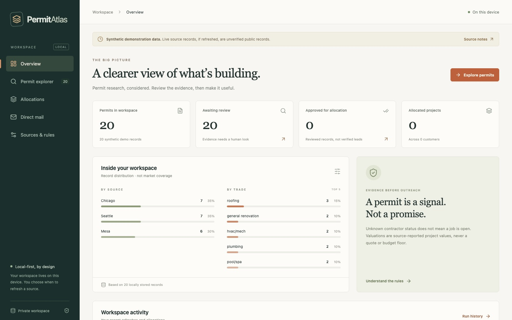
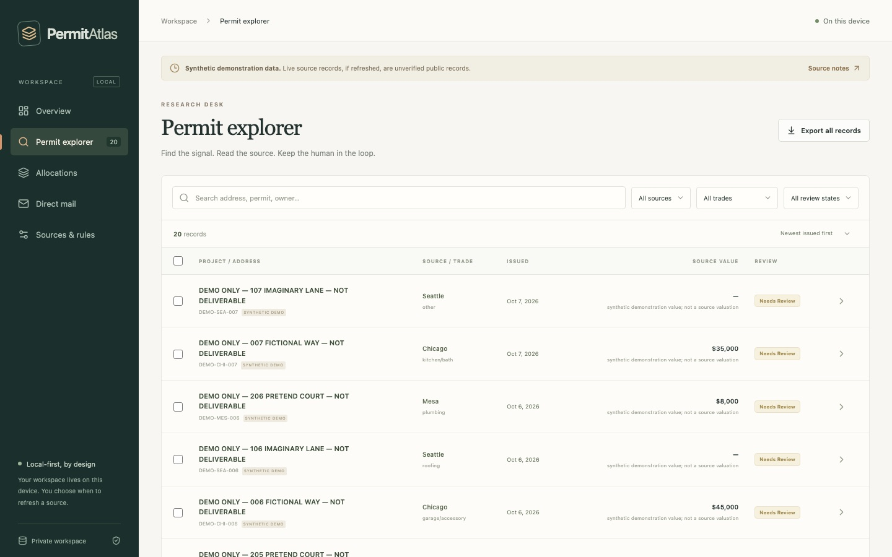

# Permit Atlas

A local-first desktop app that turns public building-permit data into reviewed, ready-to-use project leads for contractors: pull permits from city open-data portals, inspect the evidence behind each one, approve it, allocate it exclusively to a customer, and optionally prepare a postcard batch that a person reviews before anything is sent.

Built by [Mateusz Gajor](https://arctyklabs.com/projects) with Electron, React, Express and SQLite (sql.js). Apache-2.0.



## Why it exists

It started as a weekly lead workflow for a remodeling contractor who was paying thousands a month for leads and works in the Chicago and Phoenix areas. New remodeling permits turned out to be a better signal: they're public, current, and tell you what kind of work is planned.

Chicago's portal had the richest data, which raised the obvious question: is that one city's luck, or does the pattern carry over? Most cities publish permits through a small number of shared platforms rather than one-off systems, so I added Seattle as a test outside the client's area. The pattern carries over, with differences in which fields each city requires. This repository is the generalized, public version, shipped with synthetic data only.

## What it does

- **Ingests** permits from Chicago, Seattle and Mesa through their official Socrata datasets, with pagination, timeouts and explicit failure states.
- **Shows its evidence.** Every record keeps its raw source data, provenance and review notes, so you can check why it looks like a lead.
- **Keeps a person in the loop.** Records start as pending; only approved ones can be allocated or mailed.
- **Allocates exclusively.** Projects are reserved per customer with weekly caps, and related permits at the same address can't be sold twice.
- **Exports** to CSV (formula-injection safe) and to customer-ready HTML.
- **Prepares postcards** through your own [Lob](https://docs.lob.com/) account: test mode by default, explicit recipient review, a durable outbox and per-piece idempotency so a retry can't buy the same batch twice.



## Run locally

Node.js 22+ and npm:

```sh
npm ci
npm test
npm run build
npm run serve       # browser mode at http://127.0.0.1:4318
npm run desktop     # Electron desktop shell
```

A fresh workspace loads 20 fictional, undeliverable demo records. Source refresh is manual. Set `PERMIT_ATLAS_DATA_DIR` to keep a clean demo workspace separate from real data.

## Direct mail

Open **Direct mail**, add your own Lob **test** key, create a draft from approved permits with 4×6 artwork and reviewed recipient addresses, then confirm the test submission. Test mode uses Lob's test environment and doesn't print anything.

Live mail needs all three of: launching with `PERMIT_ATLAS_ALLOW_LIVE_MAIL=1`, a live key, and a typed purchase confirmation. Synthetic records can never be sent live. The per-piece cost shown in the app is your own estimate, not a Lob quote or a spending cap, so set billing limits in your Lob account. If a submission times out, its result is marked uncertain: check the provider IDs before resending.

## Packaging

```sh
npm run pack   # unpacked app for the current platform
npm run dist   # installers: macOS DMG/ZIP, Windows NSIS, Linux AppImage
```

CI builds and tests on macOS, Windows and Linux. Hands-on testing so far has been on macOS. Builds are unsigned and not notarized.

## Limits and responsibilities

- **A permit is a signal, not a promise.** A missing contractor field, an open status or an approval in this app doesn't mean a job is available or that a homeowner has agreed to be contacted.
- **Public data still carries obligations.** Marketing to people found in public records is subject to privacy and advertising rules where you operate. This software doesn't make that compliant for you.
- **Single-user and local.** The server binds to loopback and rejects cross-site requests, but it has no login or multi-user isolation. Don't expose it to the internet.

Details: [PROCESS.md](PROCESS.md) (methodology and safeguards), [PRIVACY.md](PRIVACY.md), [SECURITY.md](SECURITY.md), [CONTRIBUTING.md](CONTRIBUTING.md).

## License

[Apache License 2.0](LICENSE), with attribution in [NOTICE](NOTICE). Municipal data, provider services, trademarks and uploaded artwork aren't covered by this license. Not affiliated with or endorsed by any municipality or by Lob. Provided as-is, with no promise of lead quality, delivery or business results.
